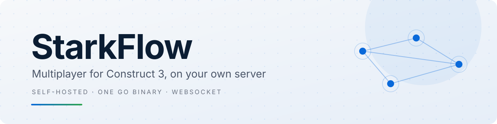
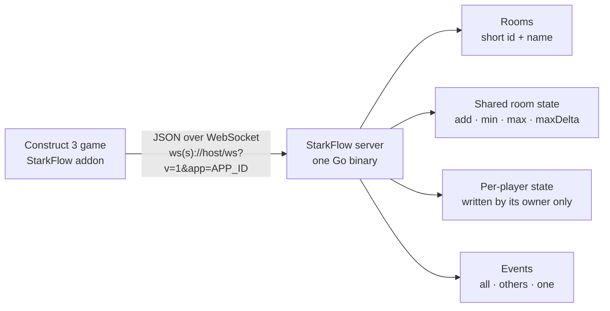
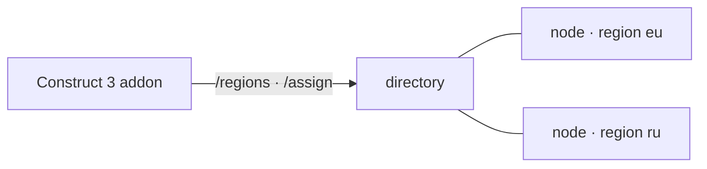

<p align="center">
  <picture>
    <source media="(prefers-color-scheme: dark)" srcset="docs/assets/banner-dark.svg">
    
  </picture>
</p>

<p align="center">
  Multiplayer for Construct 3 games on your own server: rooms, events, shared room state.<br>
  One Go binary. No external services, no sign-ups, no subscriptions.
</p>

<p align="center">
  <a href="#quick-start"><b>Quick start</b></a> ·
  <a href="docs/GAME-GUIDE.md">Game guide</a> ·
  <a href="docs/ACE.md">ACE reference</a> ·
  <a href="docs/PROTOCOL.md">Protocol</a> ·
  <a href="docs/DEPLOY.md">Deployment</a>
</p>

<p align="center">
  
  
  
  
  <a href="https://github.com/EwenLoy/starkflow/actions/workflows/ci.yml"></a>
</p>

<p align="center">
  <b>English</b> · <a href="README.ru.md">Русский</a>
</p>

## What it is

| Feature | What you get |
|---|---|
| **Rooms** | A short id plus a display name in any language (32 characters by default); duplicate names are allowed. |
| **Shared room state** | Per-key rules: `add` is atomic, `min`/`max`/`maxDelta` are clamped by the server. |
| **Relay events** | To all players, to others, or to a single player. |
| **Per-player state** | Cursors, ready flags, colours: only the player itself can write, nobody can spoof it. |
| **Object sync** | `Register object for sync` + `Start auto-sync`, the same format as GamePush Channels: the plugin sends your sprite and creates and moves one for every other player by itself, tag by tag (`On other player's object created`, `For each object`). Smoothing is configurable (`Set smoothing`, automatic delay by default). |
| **Player tokens** | Signed, nothing stored on the server: after a dropped connection the player returns to the same room with the same identity and state. |
| **Batteries included** | A test client built into the server and a Construct 3 plugin in this repository. |

Wire protocol: `ws(s)://host/ws?v=1&app=APP_ID`, JSON frames.

## Quick start

**1. Run the server** — Go 1.22+, nothing to configure:

```bash
cd server
go run ./cmd/starkflow
```

**2. Open the test client** — http://localhost:8080, the built-in test page with two demo modes: boss fight (shared
HP) and cursor synchronisation.

**3. Play with a friend** — open the same page in a second browser or in a private window.

<details>
<summary><b>Public address without Docker</b> — Cloudflare Tunnel, no account, no open ports</summary>

```powershell
powershell -ExecutionPolicy Bypass -File tools/run-public.ps1
```

The script builds the server, starts it on `localhost:8080`, runs a Cloudflare Tunnel and prints the public page
(`https://xxxx.trycloudflare.com`) plus the Construct 3 plugin URL `wss://xxxx.trycloudflare.com/ws`. No Docker, no
Cloudflare account, no open ports: `cloudflared` is downloaded automatically. The address changes on every restart,
use `-TunnelToken` for a stable hostname. See [docs/DEPLOY.md](docs/DEPLOY.md).

</details>

## Quick test with a friend (Docker)

```bash
git clone https://github.com/EwenLoy/starkflow.git
cd starkflow
docker compose up -d --build
```

That is all: the server listens on `0.0.0.0:8080` by itself, comes back up after a reboot and the container has a
healthcheck (`docker compose ps` shows `healthy`). You only need to open port 8080 in your provider's firewall. Your
friend opens `http://<server-ip>:8080` and plays.

No public IP, or you do not want to open ports? The same compose file gives you a temporary https address:

<details>
<summary><b>Docker + Cloudflare Tunnel</b> — temporary https address</summary>

```bash
docker compose --profile tunnel up -d
docker compose logs tunnel | grep trycloudflare    # prints an address like https://xxxx.trycloudflare.com
```

</details>

## Your own domain and https

One command: Caddy obtains and renews the Let's Encrypt certificate and proxies WebSocket on its own, there is nothing
to configure by hand.

```bash
cp .env.example .env     # set STARKFLOW_SECRET and SF_DOMAIN, for example game.example.com
docker compose -f docker-compose.tls.yml --profile caddy up -d --build
```

Then point an A record of your domain at the server. The plugin talks to `wss://game.example.com/ws`.

<details>
<summary>Ports 80/443 are not available, or the domain lives on Cloudflare?</summary>

The second profile in the same file runs a Cloudflare Tunnel with your token and creates the DNS record for you. Both
options are documented at the top of `docker-compose.tls.yml`.

</details>

## Architecture



Several regions? The same binary runs as a `directory` or as a `node` (`STARKFLOW_MODE`), the plugin measures latency
itself and joins the nearest region, and a room never migrates:



See [docs/CLUSTER.md](docs/CLUSTER.md).

## Requirements

| What | For |
|---|---|
| Go 1.22+ | running the server without Docker |
| Docker + Compose | deploying to a server (recommended) |
| Node 22+ | the tests in `tests/` only |
| Construct 3 | the `dist/starkflow.c3addon` addon (not yet verified inside C3 itself) |

## Tests

```bash
cd server && go test ./...       # room state and tokens
node tests/plugin-mock-test.js   # plugin: 132 ACE and behaviour on a WebSocket stub
node tests/server-smoke.mjs      # 75 protocol checks against a running server
```

All of it runs in CI on every push: 5 jobs (server, plugin, live protocol smoke test, live cluster, Docker image build).

## Repository layout

| File / folder | What is inside |
|---|---|
| `server/` | the Go server: rooms, state, tokens, the built-in test page (`internal/server/web/`) |
| `plugin/` | Construct 3 addon sources: `addon.json`, `c3runtime/`, ACE, language files |
| `dist/starkflow.c3addon` | the built addon: C3 → View → Addon Manager → Install new addon |
| `Dockerfile`, `docker-compose.yml` | the container and server deployment (includes a tunnel profile) |
| `docker-compose.tls.yml`, `Caddyfile` | https on your own domain: Caddy or a Cloudflare Tunnel |
| `tests/` | Go unit tests, ACE reference check, live protocol smoke test |
| `docs/` | the detailed documentation (currently in Russian) |

## Documentation

Detailed guides, currently in Russian:

| Guide | What is inside |
|---|---|
| [DEPLOY.md](docs/DEPLOY.md) | deployment: VPS, own domain and https, tunnels, bot hosting, environment variables |
| [PROTOCOL.md](docs/PROTOCOL.md) | protocol: messages, rooms, state key rules, the two storages |
| [PLUGIN.md](docs/PLUGIN.md) | installing the plugin and a first example in C3 (including how to read the room list) |
| [GAME-GUIDE.md](docs/GAME-GUIDE.md) | building a game step by step: lobby with a room list, room state, player state, events, errors |
| [ACE.md](docs/ACE.md) | every action, condition and expression with parameters, error codes and server limits |
| [DEVELOPMENT.md](docs/DEVELOPMENT.md) | local run, test client, tests, CI, what is verified and what is not |
| [CLUSTER.md](docs/CLUSTER.md) | several regions and a directory node: modes, tickets, the admin page |

Every document links back to the index — [docs/README.md](docs/README.md) (where to start, which file answers what).

## License and support

MIT: do anything you want, commercial games included; the only condition is keeping the [LICENSE](LICENSE) text and
the copyright notice. If the project saved you time, you can [support development](https://dalink.to/ewenloy) — it is
voluntary and changes nothing about the license or how fast issues are answered.
