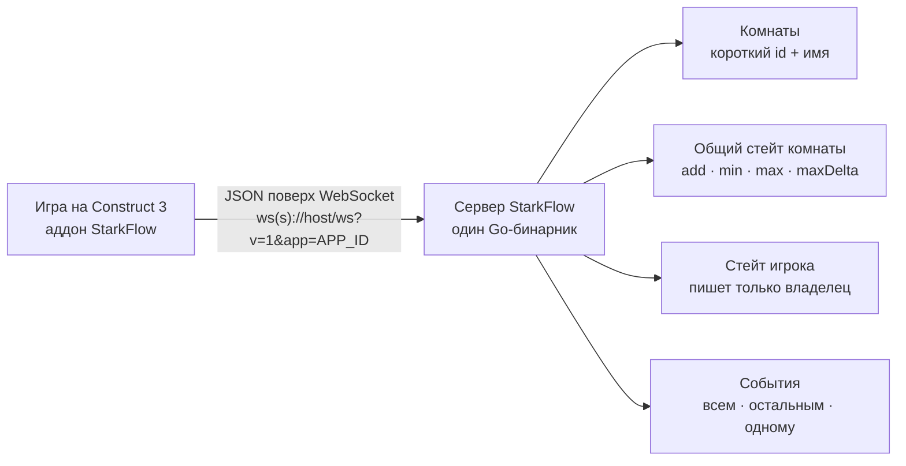
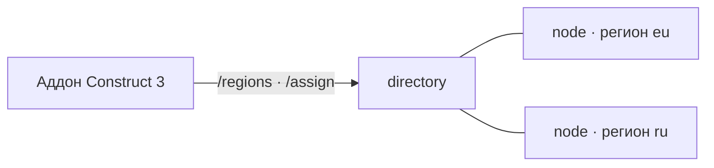

<p align="center">
  <picture>
    <source media="(prefers-color-scheme: dark)" srcset="docs/assets/banner-dark.svg">
    
  </picture>
</p>

<p align="center">
  Мультиплеер для игр на Construct 3 на своём сервере: комнаты, события, общий стейт комнаты.<br>
  Один Go-бинарник. Без внешних сервисов, регистраций и подписок.
</p>

<p align="center">
  <a href="#быстрый-старт"><b>Быстрый старт</b></a> ·
  <a href="docs/GAME-GUIDE.md">Гайд по игре</a> ·
  <a href="docs/ACE.md">Справочник ACE</a> ·
  <a href="docs/PROTOCOL.md">Протокол</a> ·
  <a href="docs/DEPLOY.md">Деплой</a>
</p>

<p align="center">
  
  
  
  
  <a href="https://github.com/EwenLoy/starkflow/actions/workflows/ci.yml"></a>
</p>

<p align="center">
  <a href="README.md">English</a> · <b>Русский</b>
</p>

## Что это

| Что | Что получаешь |
|---|---|
| **Комнаты** | Короткий id плюс имя на любом языке (по умолчанию до 32 символов), одинаковые имена разрешены. |
| **Общий стейт комнаты** | Правила ключей: `add` атомарный, `min`/`max`/`maxDelta` зажимает сервер. |
| **События** | Всем, остальным или одному игроку. |
| **Стейт игрока** | Курсоры, флаги, цвет: пишет только сам игрок, чужие значения не подделать. |
| **Синхронизация объектов** | `Register object for sync` + `Start auto-sync`, тот же формат, что в GamePush Channels: плагин сам шлёт твой спрайт и сам создаёт и двигает спрайт каждого другого игрока, по тегам (`On other player's object created`, `For each object`). Сглаживание настраивается (`Set smoothing`, по умолчанию — авто-задержка показа). |
| **Токены игроков** | Подписанные, на сервере ничего не хранится: после обрыва игрок возвращается в ту же комнату с той же личностью и стейтом. |
| **В комплекте** | Встроенный тестовый клиент и плагин для Construct 3. |

Протокол: `ws(s)://host/ws?v=1&app=APP_ID`, JSON-кадры.

## Быстрый старт

**1. Запусти сервер** — нужен Go 1.22+, настраивать ничего не надо:

```bash
cd server
go run ./cmd/starkflow
```

**2. Открой тестовый клиент** — http://localhost:8080, два режима: бой с боссом (общий HP) и синхронизация
курсоров.

**3. Позови друга** — открой ту же страницу во втором браузере или в приватном окне.

<details>
<summary><b>Публичный адрес без Docker</b> — туннель Cloudflare, без аккаунта и открытых портов</summary>

```powershell
powershell -ExecutionPolicy Bypass -File tools/run-public.ps1
```

Скрипт собирает сервер, поднимает его на `localhost:8080`, запускает туннель Cloudflare и печатает публичную
страницу (`https://xxxx.trycloudflare.com`) и адрес для плагина C3 — `wss://xxxx.trycloudflare.com/ws`. Docker,
аккаунт Cloudflare и открытые порты не нужны, `cloudflared` скачивается сам. Адрес меняется после каждого
перезапуска, для постоянного есть `-TunnelToken`. Подробности — в [docs/DEPLOY.md](docs/DEPLOY.md).

</details>

## Быстрый тест с другом за пару минут (Docker)

```bash
git clone https://github.com/EwenLoy/starkflow.git && cd starkflow
docker compose up -d --build
```

Дальше ничего не нужно: сервер сам слушает `0.0.0.0` на порту 8080, сам поднимается после перезапуска машины,
у контейнера есть healthcheck (`docker compose ps` показывает `healthy`). Открыть в панели сервера надо только
порт 8080. Друг заходит на `http://<IP-сервера>:8080` и играет.

Если публичного IP нет или не хочется открывать порты — тот же compose-файл даёт временный адрес с https:

<details>
<summary><b>Docker + туннель Cloudflare</b> — временный адрес с https</summary>

```bash
docker compose --profile tunnel up -d
docker compose logs tunnel | grep trycloudflare    # получишь адрес вида https://xxxx.trycloudflare.com
```

</details>

## Свой домен и https

Домен ставится одной командой: Caddy сам получит и продлит сертификат Let's Encrypt и сам проксирует
WebSocket, вручную настраивать нечего.

```bash
cp .env.example .env     # впиши STARKFLOW_SECRET и SF_DOMAIN, например game.example.com
docker compose -f docker-compose.tls.yml --profile caddy up -d --build
```

Остаётся направить A-запись домена на IP сервера. Адрес для плагина C3 получается `wss://game.example.com/ws`.

<details>
<summary>Порты 80/443 открыть нельзя (или домен живёт на Cloudflare)?</summary>

Второй профиль в том же файле поднимает туннель Cloudflare с твоим токеном, DNS-запись создастся сама. Оба
варианта описаны в шапке `docker-compose.tls.yml`.

</details>

## Архитектура



Несколько регионов? Тот же бинарник работает как `directory` или как `node` (`STARKFLOW_MODE`), плагин сам замеряет
задержку и едет в ближайший регион, а комната никогда не мигрирует:



Подробности — в [docs/CLUSTER.md](docs/CLUSTER.md).

## Требования

| Что | Зачем |
|---|---|
| Go 1.22+ | запустить сервер без Docker |
| Docker + Compose | деплой на сервер (рекомендуемый путь) |
| Node 22+ | только для тестов из `tests/` |
| Construct 3 | аддон `dist/starkflow.c3addon` (в самом C3 пока не проверялся) |

## Тесты

```bash
cd server && go test ./...       # стейт комнаты и токены
node tests/plugin-mock-test.js   # плагин: 119 ACE и поведение на заглушке WebSocket
node tests/server-smoke.mjs      # 75 проверок протокола против запущенного сервера
```

Всё это работает в CI на каждый push: 5 задач (сервер, плагин, живой smoke-тест протокола, живой кластер, сборка
Docker-образа).

## Карта репозитория

| Файл / папка | Что внутри |
|---|---|
| `server/` | сервер на Go: комнаты, стейт, токены, встроенная тестовая страница (`internal/server/web/`) |
| `plugin/` | исходники аддона C3: `addon.json`, `c3runtime/`, ACE, языковые файлы |
| `dist/starkflow.c3addon` | собранный аддон: C3 → View → Addon Manager → Install new addon |
| `Dockerfile`, `docker-compose.yml` | контейнер и запуск на сервере (плюс профиль туннеля) |
| `docker-compose.tls.yml`, `Caddyfile` | https на своём домене: Caddy или туннель Cloudflare |
| `tests/` | тесты: unit-тесты Go, проверка ACE, живой smoke-тест протокола |
| `docs/` | подробная документация |

## Документация

Подробные гайды:

| Гайд | Что внутри |
|---|---|
| [DEPLOY.md](docs/DEPLOY.md) | деплой: VPS, свой домен и https, туннели, хостинг ботов, переменные окружения |
| [PROTOCOL.md](docs/PROTOCOL.md) | протокол: сообщения, комнаты, правила ключей стейта, два хранилища |
| [PLUGIN.md](docs/PLUGIN.md) | установка плагина и первый пример в C3 (включая чтение списка комнат) |
| [GAME-GUIDE.md](docs/GAME-GUIDE.md) | как сделать игру по шагам: лобби со списком комнат, стейт комнаты, стейт игрока, события, ошибки |
| [ACE.md](docs/ACE.md) | все действия, условия и выражения с параметрами, коды ошибок и лимиты сервера |
| [DEVELOPMENT.md](docs/DEVELOPMENT.md) | локальный запуск, тестовый клиент, тесты, CI, что проверено и что нет |
| [CLUSTER.md](docs/CLUSTER.md) | несколько регионов и directory-нода: режимы, билеты, админ-панель |

Каждый документ ведёт назад в индекс — [docs/README.md](docs/README.md) (с чего начать и какой файл отвечает на
какой вопрос).

## Лицензия и поддержка

MIT: можно всё, включая коммерческие игры, условие одно — сохранить текст [LICENSE](LICENSE) и копирайт.
Если проект сэкономил тебе время, можно [поддержать разработку](https://dalink.to/ewenloy) — это добровольно и
никак не влияет ни на лицензию, ни на приоритет ответов в issues.
