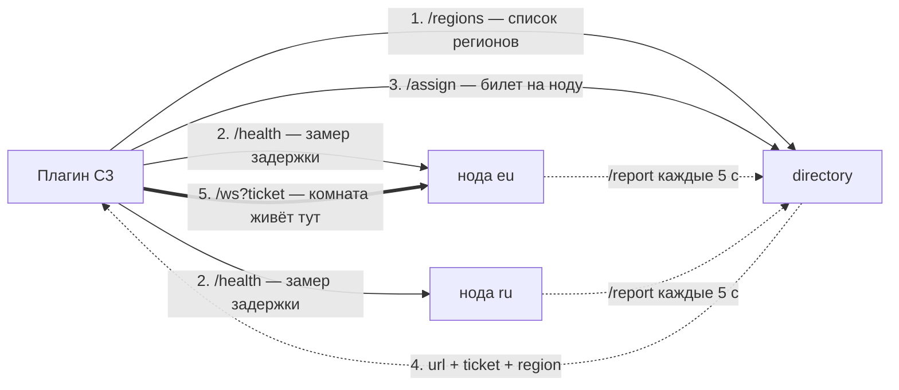

# Кластер StarkFlow: несколько нод и directory

Один бинарник, два режима. Роль задаётся переменной окружения
`STARKFLOW_MODE` — команду запуска менять не нужно (на Bothost аргументы
в контейнер не доходят, так что env — единственный рабочий способ):

| `STARKFLOW_MODE` | что делает |
|---|---|
| `node` (по умолчанию, можно не задавать) | игровой сервер: комнаты, игроки, `/ws` |
| `directory` | распределитель: `/assign`, heartbeat от нод, админ-панель `/admin/` |

Оглавление: [как это работает](#как-это-работает) · [регионы](#регионы-ближайший-выбирает-клиент) ·
[свой домен](#регион-и-развёртывание-на-своём-домене) · [проверка](#проверка-кластера) ·
[развёртывание](#развёртывание-bothost--docker) · [админ-панель](#админ-панель) ·
[ограничения](#ограничения)

## Как это работает



Порядок для игры: спросить регионы, замерить до них задержку, попросить у распределителя билет на нужную ноду,
подключиться к ней по `wss://`. Дальше всё как на обычном сервере — комната живёт на этой ноде.

- Билет — HMAC от `CLUSTER_SECRET`, живёт 60 с, привязан к App ID. Нода без
  билета в кластерном режиме (`CLUSTER_SECRET` задан) отклоняет `/ws`.
- Если `STARKFLOW_CLUSTER_SECRET` не задан — нода работает как раньше,
  standalone, билеты не требуются. Обратная совместимость полная.
- База и Redis не нужны: directory держит состояние в памяти и восстанавливает
  его из heartbeat'ов после перезапуска.
- `/assign` и `/regions` открыты для браузера (CORS). Если задан
  `STARKFLOW_ORIGINS` — доступ только с этих адресов, без него с любых (как у ноды).

## Регионы: ближайший выбирает клиент

Директор стоит в одном месте, поэтому он не знает, кто к нему ближе. Замер делает
клиент — как «best region» в Photon:

1. Нода объявляет себя: `STARKFLOW_REGION=eu` (или `ru`, `us`, …). Регион виден в
   админ-панели и в `/api/nodes`.
2. Плагин спрашивает `GET /regions` → по одному живому адресу на регион.
3. Плагин меряет задержку до каждого (две-три HTTP-пробы к `/health`, берётся
   минимум — вторая проба уже идёт по тёплому соединению) и выбирает ближайший.
4. Замер запоминается в `localStorage` на 10 минут (`starkflow:<App ID>:region`), так
   что реконнект не замеряет всё заново.
5. `POST /assign {app, room, region}` — директор выдаёт ноду **этого** региона.

Правила, которые стоит держать в голове:

- Регион выбирает только тот, кто **создаёт** комнату. Комната живёт на одной ноде
  и не мигрирует: те, кто входит в существующую комнату, едут туда, где она есть
  (аффинити по id и по имени важнее региона).
- Зафиксировать регион вручную: действие `Set region` (`eu`); пустая строка — снова
  выбирать ближайший. Текущий регион читается выражением `Region` — удобно показать
  в лобби «регион: eu».
- Если у директора один регион (или ноды без `STARKFLOW_REGION`), список короткий и
  замер не делается вовсе — поведение как раньше.
- Хочешь жёстко разделить игроков по регионам (никогда не пускать в чужой) — разделяй
  комнаты: `arena-eu`, `arena-ru`. Тогда аффинити по имени сама разведёт их по нодам.
- Старые ноды/директор без `/regions`: плагин получает 404 и просто идёт в `/assign`
  без региона. Совместимость полная.

## Регион и развёртывание на своём домене

Одна нода = один регион. На своём домене это выглядит так:

```
dir.example.com  → бот-распределитель (STARKFLOW_MODE=directory)
eu.example.com   → нода, STARKFLOW_REGION=eu, STARKFLOW_PUBLIC_URL=wss://eu.example.com/ws
ru.example.com   → нода, STARKFLOW_REGION=ru, STARKFLOW_PUBLIC_URL=wss://ru.example.com/ws
```

- На Bothost у каждого бота свой адрес `*.bothost.tech`; свои имена — либо через
  поддержку (они выдают IP для A-записи), либо через Cloudflare-туннель в контейнере
  (`CF_TUNNEL_TOKEN`) с публичным хостнеймом на твой поддомен.
- Главное условие осмысленных регионов — ноды физически в разных точках. Если все
  боты стоят в одной стойке Bothost, замер покажет одинаковые цифры и «ближайший» ничего
  не изменит. Смешивать можно: нода на VPS в EU + бот на Bothost в RU.
- `STARKFLOW_REGION` — просто метка в heartbeat. Никакой GeoIP не нужен, и он намеренно
  не используется: замер с клиента всегда точнее.
- Игровая страница на https → и directory, и все ноды должны быть на https/wss
  (иначе браузер заблокирует и `fetch` к директору, и сокет).

## Проверка кластера

`tests/cluster-e2e.mjs` проверяет всё сразу: CORS-preflight, список регионов, выбор
региона, приём билета нодой, аффинити комнаты (по id и по имени) и вход второго
клиента в ту же комнату.

```powershell
# укажи свой директор, если он не на localhost:8097
$env:SF_DIR='https://dir.example.com'; node tests/cluster-e2e.mjs
```

## Развёртывание (Bothost / Docker)

1. **Directory (распределитель)**: бот из того же образа, env:
   `STARKFLOW_MODE=directory`, `STARKFLOW_CLUSTER_SECRET`, `STARKFLOW_ADMIN_TOKEN`.
   Панель: `https://dir.../admin/`.
2. **Каждая нода**: env `STARKFLOW_DIRECTORY_URL` (адрес directory),
   `STARKFLOW_PUBLIC_URL` (свой публичный `wss://.../ws`), `STARKFLOW_REGION`,
   тот же `STARKFLOW_CLUSTER_SECRET`. `STARKFLOW_MODE` можно не задавать
   (по умолчанию `node`). Нода регистрируется сама — ничего
   вручную добавлять не нужно.
3. В Construct-плагине: поле Server URL — `https://dir...` (directory), App ID — как
   раньше, свойство **Connection mode** можно оставить Auto. Плагин сам спрашивает
   `/regions`, замеряет задержки, ходит в `/assign` и переподключается.

## Админ-панель

`/admin/` — токен из `STARKFLOW_ADMIN_TOKEN`. Таблица нод: регион, статус,
**живый пинг (RTT до /health)**, число комнат и игроков, время последнего
heartbeat. Кнопки: **Drain** (нода перестаёт получать новые комнаты, старые
доживают) и **Кикнуть** по комнате.

Порядок вывода ноды из ротации: Drain → дождаться, пока комнаты опустеют
(Players → 0) → выключить контейнер.

## Ограничения

- Одна комната живёт на одной ноде и не мигрирует.
- Нода упала → её комнаты пропали; клиенты реконнектятся и создают заново.
- `room.list` в лобби локален для ноды (сквозного списка нет).
- Директор узнаёт о новой комнате из heartbeat'а ноды — до 5 с. Раньше этого момента
  affinity по имени ещё не работает и такой заход уедет на наименее загруженную ноду.
  По id работает сразу, как только комната попала в отчёт.
- Join-by-имени между нодами — best-effort: affinity по имени работает, когда
  плагин переподключается с известной комнатой; первый заход по имени идёт
  на наименее загруженную ноду региона.
- Состояние директора — в памяти: после перезапуска оно собирается из heartbeat'ов
  заново, но до первого отчёта нод комнаты «невидимы».

---

[← Все документы](README.md) · [DEPLOY.md](DEPLOY.md) · [PROTOCOL.md](PROTOCOL.md)
