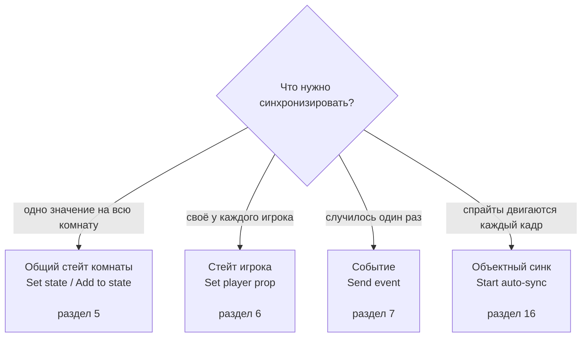

# Как сделать игру на StarkFlow (Construct 3)

Пошагово: от пустого проекта до лобби со списком комнат и общего стейта. Все ACE с параметрами — в
[ACE.md](ACE.md), установка аддона — в [PLUGIN.md](PLUGIN.md), полный пример на чистом JS — тестовая страница
сервера (`http://localhost:8080`), которая делает ровно то же самое, что описано здесь.

## Содержание

**Старт:** [0. Что нужно заранее](#0-что-нужно-заранее) · [1. Скелет проекта](#1-скелет-проекта) ·
[2. Подключение](#2-подключение) · [3. Список комнат](#3-список-комнат-как-читать-и-как-перебирать) ·
[4. Вход и создание комнаты](#4-вход-и-создание-комнаты)

**Стейт и события:** [5. Общий стейт комнаты](#5-общий-стейт-комнаты-hp-босса-счёт-фаза) ·
[6. Стейт игрока](#6-стейт-игрока-курсоры-ready-цвет) · [7. События](#7-события--одноразовые-сообщения) ·
[8. Игроки и хост](#8-игроки-и-хост) · [9. Обрыв связи и токен](#9-обрыв-связи-и-токен-игрока) ·
[10. Ошибки](#10-ошибки-что-показывать-игроку)

**Дальше:** [11. Чего пока нет в плагине](#11-что-пока-недоступно-из-плагина-важно-знать) ·
[12. Чеклист «не работает»](#12-чеклист-не-работает) · [13. Полный пример](#13-полный-пример) ·
[14. Комнаты с паролем](#14-комнаты-с-паролем) · [15. Рейт-лимит](#15-рейт-лимит-не-заваливать-сервер) ·
[16. Синхронизация объектов](#16-синхронизация-объектов)

## Куда что класть



Коротко: **значение, которое живёт** — в стейт (комнаты или игрока), **момент, который случился** — в событие,
**движение спрайтов** — в объектный синк, который делает всё сам.

## 0. Что нужно заранее

1. Аддон `dist/starkflow.c3addon` установлен в C3 (View → Addon Manager → Install new addon). После каждого
   обновления аддона его надо **переустановить** — C3 кэширует старую версию.
2. Сервер запущен и доступен. Локально — `http://localhost:8080`, для игры по сети — адрес с `wss://`
   (см. [DEPLOY.md](DEPLOY.md)). На https-странице (`preview.construct.net` и т. п.) `ws://` не работает.
3. Объект StarkFlow добавлен на layout, у него включено **Global** (иначе при смене layout соединение порвётся).
   Server URL — адрес сервера, App ID — название твоей игры (одинаковое у всех игроков и во всех layout'ах).

## 1. Скелет проекта

- Layout `Lobby` — здесь объект StarkFlow (уникальный, Global), поле имени, кнопки и место под список комнат.
- Layout `Game` — сама игра.
- Строка лобби — Sprite `RoomRow` с дочерним Text (Pin → привязка к `RoomRow`), с instance variable
  `roomId` (текст). Из этих строк и будет собираться список комнат.

## 2. Подключение

```
On start of layout
    → StarkFlow: Connect ("", "")            // адрес и токен из свойств и localStorage
    → Status: Set text "подключаюсь…"

StarkFlow: On connected
    → Status: Set text "в сети, " & StarkFlow.MyUserId
    → StarkFlow: Request rooms                // сразу спрашиваем список комнат
    → (если нужно) StarkFlow: Set name (NameInput.Text)

StarkFlow: On reconnecting
    → Status: Set text "переподключаюсь…"

StarkFlow: On disconnected
    → Status: Set text "нет связи"
```

`Connect` можно вызывать и на `On start of layout` любого layout — повторный вызов просто переоткрывает сокет.

### Если сервер кластером (несколько регионов)

Ничего в событиях менять не надо: адрес в свойстве Server URL указывает на распределитель (`https://dir.example.com`),
плагин сам замерит задержки, выберет ближайший регион и подключится к нужной ноде. Отличия, которые видно из игры:

```
StarkFlow: On connected
    → Status: Set text "в сети, " & StarkFlow.MyUserId & " (" & StarkFlow.Region & ")"
```

- `StarkFlow.Region` — регион текущего подключения (`eu`, `ru`, …), вне кластера пустая строка.
- Действие `StarkFlow: Set region ("eu")` — заставить играть в конкретном регионе (например, кнопкой «сервер: EU»);
  пустая строка — снова выбирать ближайший.
- Кто первым создал комнату, тот и определяет её регион: остальные попадают туда же, даже если он далеко.
  Хочешь жёстко развести игроков по регионам — делай разные комнаты (`arena-eu`, `arena-ru`).

Подробности и настройка сервера — `docs/CLUSTER.md`.

## 3. Список комнат: как читать и как перебирать

Список комнат приходит **массивом внутри плагина**, а не объектом C3. Поэтому:

- сколько комнат пришло — `StarkFlow.RoomCount`;
- данные комнаты с номером `i` — `RoomNameAt(i)`, `RoomIdAt(i)`, `RoomPlayersAt(i)`, `RoomMaxAt(i)`;
- перебор — `System: Repeat StarkFlow.RoomCount times`, внутри цикла номер берётся из `loopindex` (он и есть `i`).

Создать строку на каждую комнату:

```
StarkFlow: On room list received
    → RoomRow: Destroy                             // или Pick all RoomRow → Destroy: чистим старый список
    → System: Repeat StarkFlow.RoomCount times
        → System: Create object RoomRow at (32, 120 + loopindex * 48)
        → RoomRow: Set instance variable roomId to StarkFlow.RoomIdAt(loopindex)
        → RoomRow: Set instance variable roomName to StarkFlow.RoomNameAt(loopindex)
        → Text (child, pinned to RoomRow): Set text to
              StarkFlow.RoomNameAt(loopindex) & "   " &
              StarkFlow.RoomPlayersAt(loopindex) & "/" & StarkFlow.RoomMaxAt(loopindex) &
              (StarkFlow.RoomIsFullAt(loopindex) = 1 ? "  занята" : "  свободно " & StarkFlow.RoomFreeAt(loopindex)) &
              (StarkFlow.RoomLockedAt(loopindex) = 1 ? "  🔒" : "")
```

Клик по строке — вход именно в ту комнату (по id, имена комнат не уникальны). Одним действием закрываются оба
случая: у открытой комнаты пароль просто игнорируется, у закрытой проверяется (ошибка 307, если пароль не тот):

```
RoomRow (Sprite): On clicked
    → StarkFlow: Join room with password (RoomRow.roomId, PasswordInput.Text)
```

Как сделать саму закрытую комнату — в разделе [14](#14-комнаты-с-паролем).

Обновление списка: кнопка «Обновить» → `StarkFlow: Request rooms`. Можно дёргать по таймеру (`Every 3.0 seconds`),
но тогда не забывай снимать таймер, когда ты уже в комнате.

Быстрая игра — «войти в любую свободную комнату или создать свою» — одним действием:

```
Button "Играть" (On clicked)
    → StarkFlow: Join random or create room ("room1", 8, 300, fill rooms, "arena")
```

Последний параметр — **лобби**: строка-метка. Если она задана, в быструю игру попадают только комнаты
этого лобби, а созданная комната получает ту же метку; пусто — все комнаты приложения, как раньше. Так
можно развести режимы (`"pvp"`, `"coop"`) или регионы в одном приложении — игроки разных лобби друг
друга не встретят.

Плагин сам спрашивает список комнат, выбирает подходящую и входит по id; полные и закрытые паролем комнаты
пропускает. Свободных нет — создаёт свою (`"room1"`; пустое имя = вида `room-x7k2p`). `Matching`:

- **fill rooms** — самая полная из свободных: комнат в игре меньше всего;
- **random** — любая свободная;
- **in list order** — первая свободная в списке (по имени, потом по id): игроки собираются в одну комнату, пока
  в ней есть места.

Если выбранную комнату заняли, пока ты входил (**301**), её закрыли (**302**) или она исчезла (**300**), плагин
молча создаёт свою — `On error` не срабатывает. `On joined room` придёт один раз, как при обычном входе.

То же вручную (`Request rooms` → `Repeat StarkFlow.RoomCount` → `Join room (RoomIdAt(loopindex))` → если не
нашли, `Join or create room`) тоже работает, но гонку «комнату заняли между списком и входом» придётся ловить
самому.

### «А можно через For each?»

- `For each` в C3 перебирает **инстансы объектов**, а не данные из плагина. Поэтому паттерн выше — `Repeat` +
  `loopindex`; он же работает, если игроков/комнат много.
- Если хочется именно `For each`, сначала переложи данные в объект: `Array: Set size (StarkFlow.RoomCount, 1, 1)`,
  затем в цикле `Repeat` → `Array: Set value at (loopindex, 0) to StarkFlow.RoomIdAt(loopindex)` и т. д. Дальше
  работаешь с `Array.At(x, 0)` и можешь, например, отсортировать по числу игроков или отфильтровать полные
  комнаты, а строки (`System: For each RoomRow`) создавать уже по данным массива.
- Обратное тоже верно: чтобы показать список игроков, перебирай `System: Repeat StarkFlow.PlayerCount times` и
  читай `StarkFlow.PlayerIdAt(loopindex)`.

## 4. Вход и создание комнаты

```
Button "Создать комнату" (On clicked)
    → StarkFlow: Join or create room (RoomNameInput.Text, 8, 300)
          // 8 — максимум игроков, 300 — сколько секунд живёт пустая комната (-1 = по умолчанию сервера)

StarkFlow: On joined room
    → System: Go to layout "Game"
    → Text RoomLabel: Set text StarkFlow.RoomName & "  (" & StarkFlow.RoomId & ")"
    → (если StarkFlow.Is host) — мы хост: инициализируем стейт комнаты, см. раздел 5
```

`Join or create room` сначала пробует войти в комнату с таким именем, а если её нет — создаёт. Поэтому им удобно
делать «Играть с друзьями по коду комнаты». Для быстрой игры без кода комнаты есть `Join random or create room`
(раздел [3](#3-список-комнат-как-читать-и-как-перебирать)): он входит в любую свободную комнату, а если таких нет —
создаёт свою.

`Resumed` = 1 означает «мы вернулись в комнату, где уже были» — в этом случае не сбрасывай игру и не
пересоздавай стейт.

## 5. Общий стейт комнаты: HP босса, счёт, фаза

Инициализирует тот, кто создал комнату (хост), и только если стейт пустой:

```
StarkFlow: On joined room
    → StarkFlow: Is host                                  // условие
    → StarkFlow.State("boss_hp") = 0                      // условие, то есть стейта ещё нет
        → StarkFlow: Set state ("boss_hp", 100)
        → StarkFlow: Set state ("phase", "fight")
```

Удар по боссу — атомарная прибавка, удары игроков не теряются:

```
Player: On key "Space" pressed
    → StarkFlow: Add to state ("boss_hp", -10)
    → StarkFlow: Send event (1, "", "others")             // проиграть эффект у остальных
```

Отрисовка и реакция:

```
StarkFlow: On state "boss_hp" changed
    → BossHpText: Set text StarkFlow.State("boss_hp")
    → (StarkFlow.ChangedBy — кто ударил; StarkFlow.ChangedOld — сколько было)

StarkFlow: On state "boss_hp" changed
    → StarkFlow.State("boss_hp") <= 0                     // условие
        → StarkFlow: Set state ("phase", "win")
```

Ключи стейта комнаты — только латиница, цифры, `_` и `.`, до 64 символов; значения число/строка/bool; лимиты —
64 ключа, 64 КБ, 20 записей в секунду на игрока. Значение одного и того же ключа не может менять тип
(если `boss_hp` число, строку туда не запишешь).

## 6. Стейт игрока: курсоры, ready, цвет

Здесь никто никого не подделает: писать может только сам игрок.

```
Every 0.1 seconds
    → StarkFlow: Set player prop ("x", Player.X)
    → StarkFlow: Set player prop ("y", Player.Y)

StarkFlow: On player prop ("x") changed
    → Cursor: Pick instance with PlayerUserId = StarkFlow.PlayerUserId(StarkFlow.LastPlayerId)
    → Cursor: Set position to (StarkFlow.PlayerProp(StarkFlow.LastPlayerId, "x"),
                              StarkFlow.PlayerProp(StarkFlow.LastPlayerId, "y"))

Button "Готов" (On clicked)
    → StarkFlow: Set player prop ("ready", 1)
```

Перебор всех игроков и их курсоров:

```
Every 0.1 seconds
    → System: Repeat StarkFlow.PlayerCount times
        → System: Set local variable pid to StarkFlow.PlayerIdAt(loopindex)
        → StarkFlow.PlayerStatus(pid) = "active"     // условие: пропускаем тех, кто отвалился
            → ... StarkFlow.PlayerName(pid), StarkFlow.PlayerProp(pid, "x") ...
```

Не пересылай стейт чаще ~20 раз в секунду: лимит — 60 сообщений в секунду на игрока, и в него же упирается всё
остальное.

## 7. События — одноразовые сообщения

Событие подходит для «выстрелил», «прыгнул», «взял бонус» — то, что не хранится, а случается.

```
Player: On key "Space" pressed
    → StarkFlow: Send event (1, str(Player.X) & "," & str(Player.Y), "others")

StarkFlow: On event (1)
    → System: Set local variable x to tokenat(StarkFlow.EventData, 0, ",")
    → System: Set local variable y to tokenat(StarkFlow.EventData, 1, ",")
    → ... создай эффект в (x, y) ...
    → (StarkFlow.EventFrom — id игрока, который прислал событие)
```

Доставка: `to` = пусто или `others` — всем кроме себя, `all` — всем, `"2"` — конкретному игроку по id.
События не сохраняются: кто не в комнате или пропустил момент — не получит.

## 8. Игроки и хост

`MyName` — свой ник (до входа это то, что задал `Set player name`, после входа — имя, подтверждённое сервером).
Чужой ник берётся по id: `PlayerName(id)`, в триггере — `PlayerName(LastPlayerId)`, в переборе —
`PlayerName(CurrentPlayerId)` или сразу `PlayerNameAt(loopindex)`. Подробнее — в [ACE.md](ACE.md#ники-игроков).
Ник фиксируется при подключении (`hello`): чтобы сменить его, надо переподключиться.

```
StarkFlow: On player joined
    → Text Log: Append "вошёл " & StarkFlow.PlayerName(StarkFlow.LastPlayerId)

StarkFlow: On player connection lost
    → Cursor: Pick by PlayerUserId = StarkFlow.PlayerUserId(StarkFlow.LastPlayerId)
    → Cursor: Set opacity 40

StarkFlow: On player resumed
    → ... вернуть обычный вид ...

StarkFlow: On player left
    → Cursor (по id StarkFlow.LastPlayerId): Destroy

StarkFlow: On host changed
    → StarkFlow: Is host       // условие: теперь мы хост
        → включить кнопку "Начать игру"
```

Хост — самый старый активный игрок. Он сам «переезжает», когда хост уходит: `Is host` и `On host changed`
позволяют держать у хоста кнопки старта и инициализацию стейта.

## 9. Обрыв связи и токен игрока

Плагин сам восстанавливает соединение: до 10 попыток, пауза 1 с и дальше ×2 до 8 с, затем возврат в ту же
комнату по её id. Тебе остаётся показать состояние:

```
StarkFlow: On reconnecting  → Status: Set text "переподключаюсь…"
StarkFlow: On connected     → (после обрыва Status снова "in-room", комната та же)
StarkFlow: On disconnected  → показать экран "связь потеряна" и кнопку "Переподключиться"
```

Токен игрока (`AuthToken`) даёт «тот же userId после обрыва» и кладётся в `localStorage` автоматически. В
worker-режиме C3 `localStorage` недоступен, поэтому сохраняй токен сам:

```
StarkFlow: On connected
    → LocalStorage: Set item "sf_token" to StarkFlow.AuthToken

On start of layout
    → StarkFlow: Set auth token (LocalStorage.ItemValue("sf_token"))
    → StarkFlow: Connect ("", "")
```

Если сервер обновили и сменили секрет, старый токен перестаёт работать: приходит ошибка 200, плагин забывает
токен и получает нового игрока — просто сохрани новый `AuthToken`.

## 10. Ошибки: что показывать игроку

```
StarkFlow: On error
    → Text Err: Set text "ошибка " & StarkFlow.ErrorCode & ": " & StarkFlow.ErrorMsg
```

Частые коды: 301 — комната полна, 306 — плохое имя комнаты, 303 — ты уже в комнате, 500 — слишком часто,
501 — сообщение больше 16 КБ. Полная таблица — в [ACE.md](ACE.md#errors--ошибки-от-сервера).
Ошибка — не повод перезапускать игру: 300 и 200 плагин обрабатывает сам. У «Войти или создать» пробный вход
заведомо получает 300, и плагин молча переходит к созданию комнаты — `On error` тут не срабатывает, показывать
игроку «комната не найдена» не нужно. Сам плагин ничего не показывает: ни `alert`, ни своих надписей —
только строки в консоль браузера (свойство `Log level`).

**Никаких `Browser: Alert` на ошибках.** Модальное окно блокирует игру, останавливает ввод и мешает
автоматическому реконнекту, а ошибка почти всегда не критична. Всё — в лог, игроку — максимум строчка в HUD:

```
StarkFlow: On error
    → Browser: Log "starkflow error " & StarkFlow.ErrorCode & ": " & StarkFlow.ErrorMsg
    → ErrLabel (HUD): Set text to "ошибка " & StarkFlow.ErrorCode
    → ErrTimer: Set timer "hide err" to 3

ErrTimer: On timer "hide err"
    → ErrLabel: Set text to ""
```

Тот же принцип для остальных «крупных» ошибок — `On disconnected`, `On rate limited`, отказ directory:
`Browser: Log` плюс строка в HUD, никаких всплывающих окон.

## 11. Что пока недоступно из плагина (важно знать)

Правила стейта (`schema`: `kind`, `mode`, `min`, `max`, `maxDelta`, `reject`, `maxLen`), начальные значения
(`init`) и режим `strict` сервер умеет, но у плагина **пока нет действия, чтобы их передать**. Из C3 комната
создаётся без схемы, а это значит:

- любой ключ создаётся первым `set`, тип берётся из первого значения (число/строка/bool) и потом не меняется;
- значения не зажимаются по `min`/`max`, `maxDelta` не ограничивает прибавку;
- ограничения остаются только общие: 64 ключа, 64 КБ, 20 записей в секунду, строка до 4096 байт.

Поэтому в игре клампь значения сам (`clamp(hp, 0, 100)`), а если нужны серверные правила — они доступны из
JS-клиента (тестовая страница работает именно так, `room.join` с `schema`/`init`/`strict`). Скажи, если нужно
действие вида «создать комнату с правилами» — это добавляется в плагин.

## 12. Чеклист «не работает»

| Симптом | Причина и что делать |
|---|---|
| В консоли `WebSocket connection to 'ws://…' failed` и код 1006 | Сервер не запущен или адрес неверный. Проверь `http://localhost:8080` в браузере |
| Из облачного предпросмотра C3 не подключается к `ws://localhost` | Страница на https + новые проверки браузера. Нужен `wss://`: туннель или свой домен, см. [DEPLOY.md](DEPLOY.md) |
| `Server URL must start with ws:// or wss://` | В свойстве указан http-адрес. Нужен `ws://` или `wss://` |
| On connected не срабатывает, ошибок нет | Объект StarkFlow исчез при смене layout (не включено Global) или `Connect` не вызывался |
| Список комнат пуст | Ты не в лобби, `Request rooms` не вызван, или у игроков другой App ID |
| Друг видит пустой список, хотя комнаты есть | Разные App ID или разные серверы (у тебя localhost, у друга — нет) |
| Ничего не приходит, хотя в свойствах всё верно | Переустанови аддон: C3 кэширует старую версию `dist/starkflow.c3addon` |
| Ошибка 102 сразу после Connect | `Join room` вызван до `On connected` (сервер ждёт `hello`) |
| Ошибка 400 на ключ стейта | Кириллица или пробелы в имени ключа: только латиница, цифры, `_`, `.` |
| Ошибка 401 на ключ стейта | В этот ключ уже писали значение другого типа |
| Ошибка 500 при быстром движении | Больше 60 сообщений в секунду: отправляй через `Every 0.1 seconds`, а не каждый кадр |
| Ошибка 307 при входе | Комната закрыта паролем: нужен `Join room with password`, раздел [14](#14-комнаты-с-паролем) |
| Сработал `On rate limited` | Отправляешь слишком часто: переходи на таймер и увеличь интервал, раздел [15](#15-рейт-лимит-не-заваливать-сервер) |

## 13. Полный пример

- Тестовая страница сервера — самый полный пример: лобби со списком комнат, вход, бой с боссом, синхронизация
  курсоров, таблица игроков, лимиты. Открой `http://localhost:8080` (или адрес твоего сервера) и смотри исходник:
  `server/internal/server/web/index.html`.
- Два твоих браузера (или обычное окно + приватное) на одной странице — это уже два игрока: удобно проверять
  лобби, комнаты и стейт без второго ПК.
- Живая проверка протокола без C3: `SF_WS=wss://твой-адрес/ws node tests/server-smoke.mjs` (нужен Node 22+).

## 14. Комнаты с паролем

Создать закрытую комнату:

```
Button "Создать закрытую комнату" (On clicked)
    → StarkFlow: Join or create room with password (RoomNameInput.Text, PasswordInput.Text, 8, 300)
```

Что важно знать:

- пароль на сервере хранится только как хэш (SHA-256 с солью комнаты), в списке виден лишь признак
  `RoomLockedAt(i) = 1`;
- в открытую комнату пароль можно не вводить: `Join room with password` с пустым паролем работает как обычный вход;
- неверный пароль → `On error` с `ErrorCode = 307`;
- занятое имя не «перехватить»: чужой игрок не создаст комнату с тем же именем без пароля — получит 307;
- авто-возврат после обрыва пароль не спрашивает: игрок узнаётся по токену (тот же userId), так что переподключение
  работает, даже если пароль нигде не сохранён. Меняешь политику — храни пароль сам и не полагайся на авто-возврат.

Лобби с паролем целиком:

```
Button "Играть" (On clicked)
    → StarkFlow: Join room with password (RoomIdInput.Text, PasswordInput.Text)

StarkFlow: On error
    → StarkFlow.ErrorCode = 307        // условие
        → Text Err: Set text "неверный пароль"
```

## 15. Рейт-лимит: не заваливать сервер

Сервер пропускает 60 сообщений в секунду на соединение (всплеск 120). В этот поток входят стейт игрока, события,
записи стейта комнаты и даже `ping`. Поэтому:

- меняющееся состояние (позиции) отправляй по таймеру, а не каждый кадр: `Every 0.1 seconds` — это 10 сообщений в
  секунду, `Every 0.05 seconds` — уже 20;
- если сервер отбросил сообщение, срабатывает триггер `On rate limited` (и это же `On error` с кодом 500):

```
StarkFlow: On rate limited
    → System: Set local variable sendInterval to min(Self.sendInterval * 2, 0.5)
    → Text Status: Set text "снижаю частоту отправки"
```

- полезно держать интервал отправки в переменной и увеличивать его при 500, а когда ошибок давно нет — уменьшать
  обратно, до 0.05;
- разовые вещи (выстрел, покупка, реплика) отправляй событием, а не записью стейта каждый кадр;
- не отправляй одно и то же дважды: `On state (key) changed` приходит и автору изменения, отдельная «локальная»
  запись не нужна.

## 16. Синхронизация объектов

Позиции чужих персонажей можно гонять руками через свойства игрока (раздел 6), но теперь это делает
плагин: ты говоришь ему, **что** синхронизировать, он сам шлёт твоё и сам создаёт и двигает объекты
остальных игроков.

```
System: On start of layout
    → StarkFlow: Connect ("", "")
    → StarkFlow: Set send rate (mode): medium

StarkFlow: On connected
    → StarkFlow: Join or create room ("arena", 8, 30)

StarkFlow: On joined room
    → StarkFlow: Set smoothing (auto)                               // авто-задержка показа (по умолчанию)
    → StarkFlow: Register Player as "player" in Player state (transform: Position + angle, interpolate: yes, layer: "")
    → StarkFlow: Sync variable hp of Player (interpolate: no)      // переменные - тоже в синхронизации
    → StarkFlow: Start auto-sync
```

Всё. Спрайт `Player`, который лежит на слое, плагин объявляет твоим (отдельное действие не нужно), а на
каждого другого игрока сам создаёт такой же спрайт, как только от него придут координаты, и удаляет его,
когда тот выйдет. Движение своего спрайта делай как обычно (поведение или события) — на синхронизацию это
не влияет, свой объект плагин не трогает. Переменные, добавленные через `Register object variable for sync`,
доезжают до чужих копий тем же чанком (`hp`, `ammo`, счёт); с `interpolate: yes` числа сглаживаются.

**Внешний вид и анимация.** Позиция и угол — не всё, что видно на экране. Цвет, режим смешивания,
отражение, прозрачность и видимость синхронизирует `Sync appearance`, а имя анимации, кадр, скорость и
последний кадр цикла — `Sync animations`. Оба действия — это набор галочек: включённое поле уходит другим,
снятое не трогает ничего. Ставь их после `Register object for sync` и до `Start auto-sync`:

```
StarkFlow: On joined room
    → StarkFlow: Register Player as "player" in Player state (transform: Position + angle, interpolate: yes, layer: "")
    → StarkFlow: Sync appearance of Player (blend: no, color: yes, flipped: yes, mirrored: yes, sampling: no, opacity: yes, visible: yes)
    → StarkFlow: Sync animations of Player (name: yes, frame: no, speed: yes, repeat-to: no)
    → StarkFlow: Start auto-sync
```

Для анимации хватает `name` + `speed`: чужой спрайт играет ту же анимацию с той же скоростью, кадры совпадают
сами. `frame` включай только когда нужен покадровый синк (файтинг, точный хитбокс) — это лишнее поле в каждом
кадре. `opacity` и `visible` не дублируй с `Transform: Full`, там они уже есть.


Привязка чинится сама: если инстанс удалён (смена layout, респавн) или создан уже после `Start auto-sync`,
плагин раз в полсекунды перепроверит и привяжет новый инстанс того же типа — раньше синк в этом случае
молча умирал. Если привязать нечего, в консоли есть строка `no instance of ... to bind as mine`.

Порядок действий не важен: `Register object for sync` и `Start auto-sync` можно вызывать на
`On start of layout`, до `Connect` — пока комната не открыта, у игрока ещё нет id, но после входа плагин
сам перевешивает привязку на настоящий id. Раньше в этом порядке синк молча ничего не отправлял, а
работал только вызов `Start auto-sync` внутри `On joined room`.

**Если спрайт создаётся кодом** (выбор персонажа, респавн), порядок такой: сначала `Register object for sync`
(определение тега), потом создание, потом `Bind local instance` — созданный инстанс уже выбран, поэтому
действие применится именно к нему:

```
System: On start of layout
    → StarkFlow: Register Player as "player" in Player state (transform: Position + angle, interpolate: yes, layer: "")
    → System: Create object Player on layer "Game" at (0, 0)
    → StarkFlow: Bind local instance of Player
    → StarkFlow: Start auto-sync
```

**Что делать с чужими объектами.** Они твои только визуально: имена, тинт, значок хоста — по триггеру
создания объекта. У `scope player` это `On player proxy created`, у `scope global` — `On entity created`:

```
StarkFlow: On player proxy created (tag "player")
    → System: Pick instance by unique ID StarkFlow.ProxyUID      // это и есть новый спрайт
    → NameText: Set text to StarkFlow.PlayerName(StarkFlow.ProxyPlayerId)
    → Player: Set color to rgb(StarkFlow.ProxyPlayerId * 60, 80, 200)

StarkFlow: On player proxy destroyed (tag "player")
    → System: Pick instance by unique ID StarkFlow.ProxyUID      // можно успеть прочитать позицию

StarkFlow: On entity created (tag "crate")                        // общие объекты хоста
    → System: Pick instance by unique ID StarkFlow.EntityUID
```

Позже тот же объект находится по `StarkFlow.PlayerProxyUID(playerId, "player")`, свой — по
`StarkFlow.LocalEntityUID("player")`. Отличить свои события от чужих в одном цикле просто: у объекта есть
`StarkFlow.EntityOwner`, сравнивай с `StarkFlow.MyId`.

**Когда чужой объект исчезает.** Плагин сверяется со списком игроков комнаты: если владельца в нём уже
нет, его объекты удаляются и срабатывает `On player proxy destroyed` / `On entity destroyed`. Так фантом
не останется даже тогда, когда сообщение «вышел» потерялось — например, если ты сам был на реконнекте.
Нюанс только один: при **обрыве** связи сервер держит игрока в комнате как `suspended` ещё 30 секунд
(чтобы он мог вернуться тем же id) и только потом шлёт «вышел». Пока он в комнате, его объект на месте.
Если обрыв должен считаться выходом, вызови `Set player timeout` с `0` до входа в комнату — тогда сервер
удаляет игрока сразу, приходит `On player left`, и его объекты исчезают в тот же момент.
Если нужно убрать объект сразу при обрыве и при этом сохранить возврат игрока — повесь на `On player connection lost`:

```
StarkFlow: On player connection lost
    + System: StarkFlow.PlayerStatus(StarkFlow.LastPlayerId) = "suspended"
        → System: Pick instance by unique ID StarkFlow.PlayerProxyUID(StarkFlow.LastPlayerId, "player")
        → Player: Set visible to false
```

**Перебор всех синхронизированных объектов** (например, чтобы посчитать, кто на экране):

```
Every tick
    + StarkFlow: For each object (tag "player")
        → System: Pick instance by unique ID StarkFlow.EntityUID
        → ...
        + System: StarkFlow.EntityOwner = StarkFlow.MyId    // через System: Compare two values
            → ...                                           // это мой объект
```

`StarkFlow.EntityField("x")` внутри цикла читает поле текущего объекта (`x`, `y`, `angle`, `animation`,
`frame`, `visible`, `opacity`, `width`, `height`, `mirror`).

Ещё два тега на ту же схему — например пули и ящики: `Register Bullet as "bullet" in Player state (transform:
Position)` и `Register Crate as "crate" in Player state (transform: Full)`. Один тег = один объект на игрока, поэтому «свой» ящик
и «своя» пуля живут в отдельных тегах.

### 16.1 Кого двигать и почему поведение «как есть» не подходит

Плагин никогда не трогает **твой** объект и каждый кадр сам ставит позицию **чужим**. Отсюда два правила:

- события движения должны срабатывать только на твоём инстансе. Самый простой фильтр — переменная
  инстанса: на `On start of layout` пометь инстанс, который лежит на слое (`Player: Set mine to 1`),
  у копий чужих игроков она останется 0, а в событиях движения поставь условие
  `Player: Compare instance variable mine = 1`. Второй способ — сравнивать UID объекта с
  `StarkFlow.LocalEntityUID("player")` (условие System «Pick instance by unique ID»);
- **поведения движения (Platform, 8 Direction) на синхронизируемом спрайте не годятся**: поведение
  принадлежит типу объекта, поэтому его получают и копии чужих игроков, а клавиатуру они читают ту же, что
  и ты — нажал вправо, поехали все, и синхронизация начинает с ними драться. Варианты: (1) двигать свой
  спрайт событиями (скорость × `dt`), (2) выключать поведение у копии в
  `On other player's object created` (действие поведения «Set enabled», если оно есть в списке),
  (3) низкоуровневый режим из 16.2: тогда чужие объекты создаёшь ты сам, отдельным типом объекта без
  поведения.

Заодно про столкновения: у копий чужих игроков локальные стены (`Solid`) и коллизии срабатывают так же,
как у твоих, поэтому не спавни игроков внутри стен и не проверяй попадания по чужой копии как по
источнику правды — координаты авторитетны у владельца.

### 16.2 Что внутри и когда нужен ручной режим

**Канал `sync` (текущий сервер).** Если сервер в `welcome` сообщает `sync: true`, плагин шлёт свои объекты не
через свойства игрока, а отдельным сообщением `sync` — один пронумерованный снимок всех своих объектов (`seq`,
время отправки `ts`, интервал отправки `iv`), и только когда что-то изменилось. Сервер ничего в нём не разбирает:
пересылает остальным и хранит последний снимок для тех, кто войдёт позже. На приёме плагин держит буфер снимков
каждого игрока и рисует чужие объекты **чуть в прошлом**, плавно проводя их между двумя соседними снимками
(entity interpolation). Так движение получается ровным, даже если пакеты приходят неравномерно или пачкой после
задержки. Задержку показа задаёт `Set smoothing`: в режиме `auto` (по умолчанию) это адаптивный буфер —
`1.5 × интервал отправки владельца + 3 × измеренный джиттер`, но от 40 до 400 мс (при 30/с на ровной сети —
около 50 мс). Текущий сервер шлёт `sync` сразу, не через окно батчинга, и говорит об этом полем `syncNow` в
`welcome`; старому серверу, который пропускает снимки через очередь, плагин добавляет к задержке ещё и его
`batchMs`. Джиттер — насколько неравномерно приходят снимки: его плагин меряет
сам по каждому игроку, задержка мгновенно растёт при всплеске сети и медленно опускается, когда сеть успокоилась,
поэтому ровная сеть с любым пингом не тратит лишних миллисекунд, а дёрганая — получает запас. Число — задержка в мс,
`0` — без задержки, сразу последнее значение. Часы игроков сверять не нужно: плагин сам подстраивается под
разницу часов каждого отправителя. Если снимки вдруг перестали приходить, объект не замирает: один интервал он
движется по последней скорости (экстраполяция) и за следующий интервал возвращается ровно на последний снимок —
поэтому остановившийся объект стоит на месте, а не уезжает вперёд. Пока данные идут, догон свежей позиции идёт
со скоростью не больше 1.5× своей собственной — без рывка и без резинки. Что происходит с буфером, видно в выражениях
`BufferDelay` / `BufferSize` / `Jitter` и в строке `buffer: …` в консоли (раз в 5 с при уровне лога Debug).
Лимит снимка — `STARKFLOW_MAX_SYNC_BYTES` (32 КБ). Со старым сервером
(без `sync` в `welcome`) работает схема ниже.

**Схема через свойства игрока (старый сервер).** Плагин режет данные каждого игрока на чанки (~4000 байт, на старом сервере ~1000) и кладёт их в свойства
`_sf0…_sf7` (остальные свойства игрока свободны для игры). Все чанки и свойства одного такта уходят на сервер
**одним** WebSocket-кадром `batch`, а сервер раз в 40 мс отдаёт каждому игроку накопленные изменения тоже одним
кадром, оставляя у повторяющегося ключа только последнее значение. Отправляет только владелец и только то, что менялось, поэтому
трафик примерно как у ручной схемы, а сглаживание на приёме уже настроено: по умолчанию работает
`Set smoothing (auto)` — `1.4 × интервал отправки`, но не меньше 70 и не больше 300 мс (при обычных
30/с это ровно 70 мс). Скачок больше 1000 px применяется сразу, без догоняния. Хочешь своё значение —
вызови `Set smoothing` с числом в миллисекундах (`0` — чужие объекты прыгают так же резко, как свои).
Текущее значение видно в выражении `StarkFlow.Smoothing`.

Если нужен контроль над каждым полем — есть низкоуровневые действия из раздела `Object sync` справочника
ACE: `Register sync object (advanced)` (связывает выбранные инстансы с парой «id игрока + слот» и списком галочек),
`Unregister sync object`, `Set smoothing`, `Set send rate`. Например, третий чанк-объект одного игрока
или синхронизация объекта, которым управляет хост, а не игрок:

```
StarkFlow: On joined room
    → StarkFlow: For each player
        + Player: Compare instance variable pid = StarkFlow.CurrentPlayerId
            → StarkFlow: Sync Player: owner player StarkFlow.CurrentPlayerId, slot 0, X yes Y yes Z no angle yes size no mirror yes animation yes frame no visible no opacity no

StarkFlow: On player joined
    → System: Create object Player on layer "Game" at (0, 0)
    → Player: Set pid to StarkFlow.LastPlayerId

StarkFlow: On player joined
    + Player: Compare instance variable pid = StarkFlow.LastPlayerId
        → StarkFlow: Sync Player: owner player StarkFlow.LastPlayerId, slot 0, ...
```

Такой режим требует, чтобы `owner` и `slot` совпадали у всех клиентов, и чтобы у каждого чужого объекта
инстанс уже существовал (плагин его не создаёт) — поэтому для обычной игры он не нужен.

---

[← Все документы](README.md) · [ACE.md](ACE.md) · [PROTOCOL.md](PROTOCOL.md) · [DEPLOY.md](DEPLOY.md)
