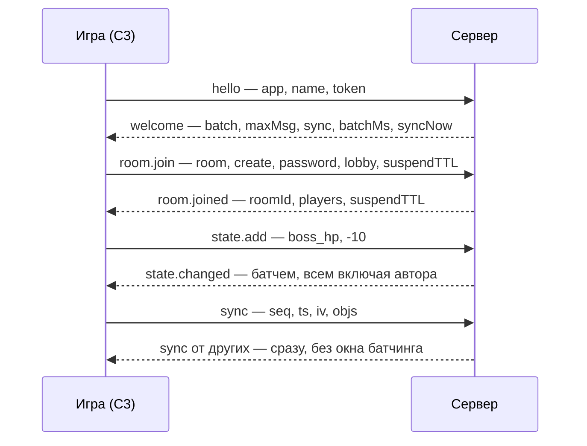

# Протокол StarkFlow

Что летит между игрой и сервером: сообщения, батчинг, стейт, объектный синк и WebRTC-канал. Схема сообщений
в коде — `server/internal/proto/proto.go`. Как этим пользоваться из Construct 3 — [GAME-GUIDE.md](GAME-GUIDE.md),
все действия и выражения плагина — [ACE.md](ACE.md).

- [Транспорт](#транспорт)
- [Сообщения](#сообщения)
- [Комнаты: id, имя, лобби, пароль](#комнаты-id-имя-лобби-пароль)
- [Обрыв связи](#обрыв-связи)
- [Подключение и вход в комнату](#подключение-и-вход-в-комнату)
- [Батчинг](#батчинг)
- [Два хранилища](#два-хранилища)
- [Правила ключей стейта](#правила-ключей-стейта)
- [Объектный синк (`sync`)](#объектный-синк-sync)
- [WebRTC-канал (`rtc.*`)](#webrtc-канал-rtc)

## Транспорт

URL: `ws(s)://host/ws?v=1&app=APPID`. Все кадры — JSON с полем `t`.

## Сообщения

| Направление | Типы |
|---|---|
| клиент → сервер | `hello`, `room.join`, `room.leave`, `room.list`, `event`, `state.set`, `state.add`, `state.toggle`, `player.set`, `ping`, `batch`, `sync` |
| сервер → клиент | `welcome`, `room.joined`, `player.joined`, `player.left`, `player.suspended`, `player.resumed`, `player.props`, `host.changed`, `event`, `state.changed`, `room.list.result`, `ok`, `err`, `pong`, `batch`, `sync` |

## Комнаты: id, имя, лобби, пароль

Комната живёт по **id** (8 hex-символов, генерирует сервер), а имя — просто метка для людей.

| Где | Что в поле `room` и что отдаёт сервер |
|---|---|
| `room.join` | `room` — либо id, либо имя. `create: true` **всегда** создаёт новую комнату (одинаковые имена разрешены). `create: false` ищет сначала по id, потом по имени — самую старую комнату с таким именем |
| `room.joined` | `roomId` — настоящий id комнаты, `suspendTTL` |
| `room.list.result` | массив `{id, room, players, maxPlayers, locked}`; у комнаты с лобби есть ещё `lobby` |
| `welcome` | `roomNameMax` — лимит длины имени |

Имена пишутся на любом языке; управляющие символы вырезаются, длина считается в символах (не в байтах).

**Лобби** — необязательная метка комнаты для матчмейкинга: `room.join` при создании принимает `lobby`
(строка, обрезается до 32 символов), а `room.list` с полем `lobby` возвращает только комнаты этого лобби
(без поля — все комнаты приложения, как раньше). Отдельного «входа в лобби» нет: это только фильтр списка.

**Закрытые комнаты**: в `room.join` можно передать `password`. Сервер хранит только хэш (SHA-256 с солью
комнаты), в списке такая комната помечена `locked: true`, а неверный или отсутствующий пароль даёт ошибку **307**.

> [!NOTE]
> Игрок, который возвращается с тем же `userId` (по своему токену), входит в закрытую комнату **без** пароля:
> это возврат в свою комнату, а не новый вход.

## Обрыв связи

По умолчанию сервер держит место за игроком, у которого пропала связь, 30 секунд: остальные получают
`player.suspended`, потом `player.left` с `reason: "timeout"`. Поле `room.join.suspendTTL` меняет это для
создаваемой комнаты:

| `suspendTTL` | Что делает сервер |
|---|---|
| не задано | берёт `STARKFLOW_SUSPEND_TTL` (по умолчанию 30 с) |
| `N` секунд | держит место `N` секунд, не больше 5 минут |
| `0` | удаляет сразу, как при `room.leave`: `player.left` с `reason: "left"` приходит в момент обрыва, а `player.suspended` не приходит вовсе |

Серверное значение по умолчанию задаёт `STARKFLOW_SUSPEND_TTL`, а `room.joined` возвращает `suspendTTL` комнаты.

## Подключение и вход в комнату

## Батчинг

`batch` — несколько сообщений одним WebSocket-кадром: `{"t":"batch","items":[...]}`, каждый элемент `items` —
обычное сообщение того же направления, порядок сохраняется.

`welcome` сообщает: `batch: true` (сервер понимает и шлёт `batch`), `maxString` и `maxPlayerProps` (лимиты
`player.set`), `maxMsg` (лимит кадра, который сервер принимает, — клиент держит батчи ниже него), `sync: true`,
`maxSync`, `batchMs` и `syncNow`.

**От клиента.**

| Правило | Результат |
|---|---|
| до 64 элементов в `batch` | норма |
| `hello` или вложенный `batch` внутри | ошибка **101** на этот элемент |
| больше 64 элементов | ошибка **501** |

Каждый элемент тратит токен лимита частоты как обычное сообщение (кадр оплачивает первый): батч экономит
кадры, а не лимит. Когда лимит исчерпан, остаток батча отбрасывается с **одной** ошибкой **500** (а не с
ошибкой на каждый элемент).

**От сервера.** `state.changed`, `player.props` и `ok` копятся отдельно для каждого получателя и уходят одним
кадром раз в `STARKFLOW_BATCH_MS` (по умолчанию 40 мс; `0` — без батчинга, кадр на каждое сообщение).

- Из нескольких `player.props` одного игрока с одним ключом за это окно уходит только последнее.
- Если накопленное не влезает в `maxMsg`, батч режется на несколько кадров.
- Остальные сообщения (`event`, `player.joined`/`left`, `sync`, `err`, …) идут сразу, но уже накопленное для
  этого получателя уходит перед ними в том же кадре, так что порядок не меняется.
- `sync` не ждёт окна вовсе: иначе каждый снимок приходил бы получателю на `batchMs` позже и неравномерно
  (несколько отправителей уезжают одним флашем), а плагин строит по приходу снимков оценку джиттера и буфер
  интерполяции.

## Два хранилища

Их легко перепутать, а правила у них разные.

| | `state.set` / `state.add` / `state.toggle` | `player.set` |
|---|---|---|
| Что это | **общий стейт комнаты** | **стейт игрока** (`player.props`) |
| Кто пишет | любой игрок в комнате | только сам игрок |
| Кому приходит | `state.changed` всем, включая автора | `player.props` остальным; вошедшему — внутри `players[].props` в `room.joined` |
| Правила | ключи и правила из `schema` | правил ключей нет |
| Лимиты | 20 записей/с на игрока, 64 ключа и 64 КБ на комнату | `STARKFLOW_MAX_PLAYER_PROPS` ключей (по умолчанию 24), `STARKFLOW_MAX_STRING_BYTES` байт на строку (4096) |
| Что здесь лежит | `boss_hp`, маркер режима `mode` | позиции курсоров; на старом сервере (без канала `sync`) ещё и чанки объектного синка `_sf0…_sf7` |

Отдельного лимита на частоту `player.set` нет — только общий лимит 60 сообщений/с на соединение (элемент
`batch` считается за сообщение).

## Правила ключей стейта

Задаются полем `schema` при создании комнаты:

| Поле | Что задаёт |
|---|---|
| `kind` | тип значения: `num`, `str`, `bool` |
| `mode` | как применяется запись: `set`, `add`, `const`, `once`, `server` |
| `min`, `max`, `maxDelta`, `reject`, `maxLen` | ограничения и поведение при нарушении |

> [!IMPORTANT]
> Из плагина Construct 3 схема пока не передаётся: комната создаётся без правил, поэтому значения не
> зажимаются по `min`/`max` и `maxDelta` не ограничивает прибавку. Клампи сам — см.
> [GAME-GUIDE.md](GAME-GUIDE.md#11-что-пока-недоступно-из-плагина-важно-знать).

## Объектный синк (`sync`)

Снимок синкаемых объектов игрока: `{"t":"sync","seq":N,"ts":мс,"iv":мс,"objs":[[slot,flags,...],...]}`.

| Поле | Что это |
|---|---|
| `seq` | растёт с каждым снимком |
| `ts` | часы отправителя в мс (сверять с другими не нужно, получатель смотрит только на разницу между снимками) |
| `iv` | интервал отправки |
| `objs` | массив записей объектов; формат записи — как в `_sf`-чанках, см. [GAME-GUIDE.md](GAME-GUIDE.md#162-что-внутри-и-когда-нужен-ручной-режим) |

Сервер содержимое не разбирает — только проверяет:

| Проверка | Ошибка |
|---|---|
| `objs` — массив | **401** |
| не больше `maxSync` байт (`STARKFLOW_MAX_SYNC_BYTES`, по умолчанию 32 КБ) | **404** |
| игрок не превысил бюджет канала `STARKFLOW_SYNC_BYTES_PER_SEC` байт/с (по умолчанию 512 КБ, `0` — без ограничения) | **500** |

Дальше пересылает остальным как `{"t":"sync","id":игрок,"seq","ts","iv","objs"}` **сразу**, не через окно
батчинга: каждый снимок нужен для интерполяции, и лишнее окно — это лишняя задержка показа.
`welcome.syncNow: true` говорит клиенту, что снимки не ждут очереди, и он не добавляет `batchMs` к задержке
буфера (старому серверу без этого поля плагин окно добавляет).

Снимок уходит всем остальным, поэтому и лимит байтовый, а не счётный. Пустой `objs: []` бюджетом не
ограничивается: он весит почти ничего, а без него у остальных навсегда остались бы копии объектов.

> [!NOTE]
> Последний непустой снимок игрока хранится и приходит вошедшим в `players[].sync`; пустой `objs: []` означает
> «объектов больше нет» и стирает его.

## WebRTC-канал (`rtc.*`)

Необязательный канал для `sync`: снимки идут по UDP, мимо WebSocket. Включается на сервере переменной
`STARKFLOW_RTC_PORT` (см. [DEPLOY.md](DEPLOY.md)). Тогда `welcome` содержит `rtc: true` и `iceServers: [...]`
(формат `RTCIceServer`, из `STARKFLOW_RTC_ICE`; без поля клиент берёт `stun:stun.l.google.com:19302`). Без порта
`rtc` в `welcome` нет, и `rtc.offer` получает ошибку **101**.

Клиент шлёт `rtc` только если в `welcome` есть и `rtc: true`, и `sync: true`; старому серверу ничего нового не
приходит. Предлагает соединение всегда клиент, сервер только отвечает. Всё идёт по уже открытому WebSocket:

| Сообщение | Кто шлёт | Что внутри |
|---|---|---|
| `rtc.offer` / `rtc.answer` | клиент / сервер | `sdp` |
| `rtc.ice` | обе стороны | `candidate: {candidate, sdpMid, sdpMLineIndex, usernameFragment}` — trickle ICE; кандидаты, пришедшие до `rtc.answer`, клиент придерживает |
| `rtc.close` | обе стороны | «эту сторону закрыли, шли `sync` по WebSocket» |

**Канал** один, его создаёт клиент: DataChannel `"sync"`, `ordered: false`, `maxRetransmits: 0`. Сообщения в
нём — текстовые JSON, ровно те же `sync`, что и по WebSocket (клиент → `{"t":"sync","seq","ts","iv","objs"}`,
сервер → с `id`); сервер может прислать и `batch` из одних `sync`. Всё, что не `sync`, клиент из канала
игнорирует. Проверки и лимиты сервер применяет те же, что для `sync` по WebSocket, но ошибку шлёт по WebSocket.

**Поведение клиента.**

- канал не открылся за 3 с — `rtc.close`, до перезагрузки страницы WebRTC больше не пробует;
- канал упал после открытия — `rtc.close`, `sync` снова идёт по WebSocket, при следующем реконнекте попытка
  будет снова;
- пустой `objs: []` всегда идёт по WebSocket (его потеря оставила бы копии объектов);
- если в канале скопилось больше 64 КБ или снимок больше `maxMessageSize`, этот снимок уходит по WebSocket;
- в worker-режиме Construct `RTCPeerConnection` нет — остаётся WebSocket.

**Поведение сервера** (`server/internal/rtc`, `server/internal/server/client.go`, `Room.Sync`):

- один UDP-порт на всех (ICE UDP mux), на соединение не больше 4 `rtc.offer` (иначе **500**), offer до 16 КБ;
- канал, не открывшийся за 15 с, закрывается;
- из канала принимается только `sync` и не чаще общего лимита сообщений (лишнее молча отбрасывается);
- на каждого получателя — `sync` либо в его открытый DataChannel, либо сразу в WebSocket (не через окно
  батчинга), **не в оба**;
- пакеты по UDP приходят не по порядку: снимок с `seq` не больше последнего принятого от этого игрока **не
  сохранять** как «последний» для вошедших (иначе устаревший снимок, пришедший после пустого `objs: []`,
  оживит копии объектов). Счётчик сбрасывать, когда игрок заново подключился (resume после перезагрузки
  страницы начинает `seq` с 1). Переслать опоздавший можно — клиент сам отбрасывает опоздавшие (`seq` в
  пределах 64 и `ts` в пределах 2 с от новейшего), а снимок с меньшим `seq`, но с более поздним `ts`, считает
  перезапуском отправителя;
- закрывать `RTCPeerConnection` при `rtc.close`, при закрытии WebSocket и если канал не открылся за разумное
  время.

---

[← Все документы](README.md) · [GAME-GUIDE.md](GAME-GUIDE.md) · [ACE.md](ACE.md)
